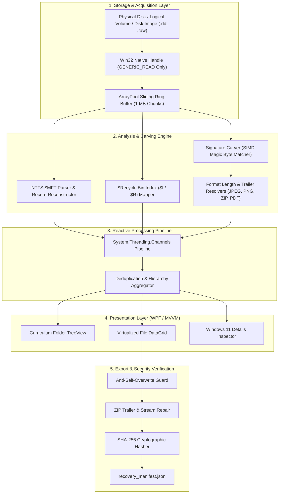

<div align="center">


<br/>

**Modern, Forensic-Grade, Security-First Data Recovery &amp; File Carving Desktop Application for Windows**

[](https://dotnet.microsoft.com/download/dotnet/8.0)
[](https://learn.microsoft.com/dotnet/csharp/)
[](https://learn.microsoft.com/dotnet/desktop/wpf/)
[](tests/DataRecovery.Tests)
[](README.md#-%EF%B8%8F-forensic-integrity--security-guarantees)
[](#)
[](LICENSE)

*Recover deleted files, reconstruct lost partition trees, carve corrupt disks, and inspect file forensics with zero telemetry, strict write-blocking, and an intuitive Windows 11 File Explorer interface.*

---

[Key Features](#-key-features) • [Architecture](#-architecture) • [Getting Started](#-getting-started) • [Developer Guide](#-developer-guide) • [Forensic Safety](#-forensic-integrity--security-guarantees)

</div>

---

## 🌟 Key Features

### 🔍 1. Dual-Engine Recovery: Deep MFT Parsing + Low-Level Sector Carving
- **NTFS Master File Table ($MFT) Engine**: Parses active and orphan `$MFT` file records, resolving resident and non-resident data attributes, exact original file names, creation/modification timestamps, and full directory tree hierarchies.
- **Windows Recycle Bin Decoder**: Tracks `$Recycle.Bin` indexes (`$I...` and `$R...` file pairs) to map deleted files back to their original names, deletion timestamps, and pre-deletion folder paths.
- **SIMD-Accelerated Raw Sector Carving**: High-throughput memory-pooled (`ArrayPool<byte>`) sliding ring buffer with lookahead overlap. Carves raw sectors and disk images (`.raw`, `.img`, `.dd`) when filesystem tables are corrupt or formatted.
- **Format-Aware Length Resolvers**: Real-time validators for JPEG, PNG, GIF, BMP, PDF, ZIP/DOCX/XLSX/PPTX, MP4/MOV, RIFF/WAV/AVI, MP3, and 7-Zip headers, atoms, and central directory trailers.

### 🗂️ 2. Curriculum Folder Tree & Full Directory Restoration
- **Windows File Explorer Navigation**: Dynamic collapsible folder tree displaying original paths (e.g. `Root Drive > Users > Documents > Project`).
- **Subfolder Hierarchy Preservation**: Export a single folder or the entire drive while maintaining the exact original nested directory structure.
- **Smart Directory Aggregation**: Instant calculation of folder item counts, combined byte sizes, and latest timestamps.

### 💻 3. Unified Windows 11 Details & Inspector Pane
- **Unified Single-Tab Details**: Merges live previews and forensic metadata into one clean inspector:
  - **Images**: High-fidelity visual preview with exact pixel resolution dimensions (e.g., `1672 × 941`), color depth, and file size.
  - **Documents & Archives**: Categorized iconography, mime-type badges, and status indicators.
  - **Folders**: Real-time folder stats, contained file count, size on disk, and directory location.
  - **Drives**: Volume labels, drive capacity, file system type (NTFS/FAT), and BitLocker status.
- **Low-Level Forensic Tabs**:
  - **💻 Hex Dump**: 512-byte sector hex editor view with byte offsets, hexadecimal grid, and ASCII decode column.
  - **📄 Text Content**: Direct UTF-8 / ASCII text preview for quick inspection of logs, source code, and text files.

### 🎯 4. Windows File Explorer-Style Filtering & Search
- **Filter Dropdowns**: Filter files on the fly by **File Type** (`Images`, `Documents`, `Video`, `Audio`, `Archives`, or specific extensions like `.png`, `.pdf`, `.zip`).
- **Date Modified Range**: Quickly narrow down by `Today`, `Past 7 Days`, `Past 30 Days`, `This Year`, or `Custom Date Range`.
- **File Size Presets**: Filter by `Tiny (< 16 KB)`, `Small (16 KB - 1 MB)`, `Medium (1 MB - 128 MB)`, `Large (128 MB - 1 GB)`, or `Huge (> 1 GB)`.
- **Instant Search**: Real-time text filtering across discovered file names and paths.

### 🖥️ 5. Ergonomic & Responsive Workspace
- **Collapsible Panes with Auto-Grow**: Independent toggles for Left Folder Tree and Right Details Pane (via top-right header controls or shortcuts `Ctrl+B` and `Ctrl+Alt+B`). Collapsing either pane automatically expands the center file list to 100% width.
- **Adjustable Resizers**: Smooth Windows 11-style draggable splitters between navigation, file table, and inspector.
- **Theme Switching**: Built-in Dark and Light themes with seamless resource switching.

### 🛡️ 6. Forensic Safety & Integrity
- **Hardware/Software Write-Blocking**: Device handles opened strictly with Windows `GENERIC_READ` (`FILE_SHARE_READ | FILE_SHARE_WRITE`), ensuring zero write operations on source disks.
- **Anti-Self-Overwrite Guard**: Validates volume serial numbers and mount points to prevent saving recovered files onto the drive being scanned.
- **Conflict Resolution Engine**: Interactive prompt offering `Overwrite`, `Rename (Keep Both)`, `Skip`, or `Apply to All` during recovery.
- **ZIP Repair & Integrity Engine**: Detects corrupted end-of-central-directory records and repairs zip headers during export for native Windows Explorer compatibility.
- **Cryptographic Audit Manifest**: Automatically generates a tamper-evident `recovery_manifest.json` with SHA-256 hashes and sector offsets.

---

## 🏗️ Architecture



---

## 📋 System Requirements

| Component | Minimum | Recommended |
|---|---|---|
| **Operating System** | Windows 10 (Build 19041+) | Windows 11 (64-bit) |
| **Architecture** | x64 | x64 |
| **Runtime** | Included in Self-Contained Release | [.NET 8.0 Desktop Runtime](https://dotnet.microsoft.com/download/dotnet/8.0) |
| **Privileges** | Standard (for disk images) / **Administrator** (for physical drives & raw partitions) | **Run as Administrator** |
| **RAM** | 4 GB | 8 GB+ |

> [!IMPORTANT]
> **Administrator Privileges Required for Physical Drives**:
> Windows security prohibits direct sector-level read access (`\\.\PhysicalDriveX` or `\\.\C:`) from standard user accounts. Always right-click and select **"Run as Administrator"** when recovering physical disks or unmounted partitions.

---

## 🚀 Getting Started

### Option 1: Standalone Portable Binary (No Installation Required)

1. Download the latest release from the [Releases](https://github.com/harshildiyora/DataRevive/releases) page.
2. Extract the archive to any folder.
3. Right-click `DataRecovery.App.exe` and select **"Run as Administrator"**.

### Option 2: Quick Launcher (From Repository)

If you have cloned the repository:
```cmd
Run-DataRecovery.bat
```

### Option 3: Run from Anywhere (Global Terminal Command)

You can launch **DataRevive** from any terminal (PowerShell, Command Prompt, Windows Terminal, or the `Win + R` Run dialog) simply by typing `datarevive`.

#### Method A: One-Line PowerShell Setup (Recommended)
Run this single command in PowerShell to permanently add the application folder to your user `PATH`:

```powershell
# Set $appPath to your DataRevive folder (e.g. where DataRecovery.App.exe is located):
$appPath = "C:\Path\To\DataRevive"

# Add permanently to your User PATH environment variable:
[Environment]::SetEnvironmentVariable(
    "Path",
    [Environment]::GetEnvironmentVariable("Path", "User") + ";$appPath",
    "User"
)
```

> [!TIP]
> To type `datarevive` instead of `DataRecovery.App.exe`, create a `datarevive.cmd` file in that same folder with:
> ```cmd
> @start "" "%~dp0DataRecovery.App.exe" %*
> ```
> Or create a copy named `datarevive.exe`.

#### Method B: Windows GUI Setup (System Environment Variables)
1. Press `Win + S`, type **"Environment Variables"**, and select **"Edit environment variables for your account"**.
2. Under **User variables**, select the **`Path`** row and click **Edit**.
3. Click **New** and paste the folder path containing `DataRecovery.App.exe`.
4. Click **OK** to save and close all dialogs.
5. Open any new PowerShell or CMD window and run:
   ```cmd
   datarevive
   ```

---

## 🛠️ Developer Guide

### Prerequisites
- [Git](https://git-scm.com/)
- [.NET 8.0 SDK](https://dotnet.microsoft.com/download/dotnet/8.0)
- Visual Studio 2022 (v17.8+) with *.NET Desktop Development* workload, or Visual Studio Code / Antigravity IDE with C# Dev Kit.

### 1. Clone the Repository
```bash
git clone https://github.com/your-username/data-recovery-software.git
cd data-recovery-software
```

### 2. Restore & Build the Solution
```bash
dotnet restore
dotnet build -c Release
```

### 3. Run Automated Tests
The test suite validates synthetic disk generation, byte-for-byte carving, SHA-256 hashes, and security boundaries:
```bash
dotnet test tests/DataRecovery.Tests/DataRecovery.Tests.csproj -c Release
```

### 4. Publish Self-Contained Executable
To generate a single portable output directory with all native and WPF dependencies bundled:
```powershell
dotnet publish src/DataRecovery.App/DataRecovery.App.csproj `
    -c Release `
    -r win-x64 `
    --self-contained true `
    -o "bin/Release/app"
```

---

## 📖 User Walkthrough

```
[ Step 1: Select Drive ] ──▶ [ Step 2: Live Scan ] ──▶ [ Step 3: Browse & Inspect ] ──▶ [ Step 4: Export Safely ]
```

1. **Select Target Drive**:
   - The home screen enumerates all local disks, removable drives, and USB flash drives with capacity bars and file system indicators.
   - You can also load forensic disk images (`.raw`, `.img`, `.dd`).
2. **Execute Scan**:
   - Click **"Scan Drive"**. The engine will read the partition table, parse the Master File Table for deleted records, and simultaneously carve unallocated sectors.
   - Monitor real-time throughput (`MB/s`), sector progress, ETA, and discovered file counters.
3. **Browse Curriculum Folder Structure**:
   - Expand the folder hierarchy on the left pane to explore original folders.
   - Click any folder to see aggregated folder statistics (size, contained files, modification dates).
4. **Inspect Files in Windows 11 Details Pane**:
   - Click any file to view its dimensions, sector offset, SHA-256 hash, and resident status.
   - Image files display an instant render preview.
   - Switch to **💻 Hex Dump** to view raw sector bytes.
5. **Export & Recover**:
   - Export individual files with **📥 Export File**, entire directories with **📦 Export This Folder**, or all discovered data with **📦 Export All Found**.
   - If a file with the same name already exists in the destination, the conflict dialog lets you rename, overwrite, or skip.

---

## 📁 Repository Structure

```
data-recovery-software/
├── src/
│   ├── DataRecovery.Core/                  # Low-Level Forensic Engine Library
│   │   ├── Storage/                        # Win32 CreateFileW unbuffered read & drive detection
│   │   ├── Signatures/                     # Magic header/footer signatures & length resolvers
│   │   ├── Engine/                         # MFT parser, Recycle Bin decoder, SIMD sector carver
│   │   └── Security/                       # Anti-overwrite guard, ZIP repair, SHA-256 manifest
│   │
│   └── DataRecovery.App/                   # Modern WPF Desktop Client
│       ├── Models/                         # FolderTreeNode, navigation hierarchies
│       ├── ViewModels/                     # MVVM orchestrators (MainViewModel)
│       ├── Views/                          # MainWindow.xaml & custom dialogs
│       ├── Converters/                     # Value converters & UI brushes
│       ├── Services/                       # ThemeService (Dark/Light)
│       └── Assets/                         # Application branding and vector icons
│
├── tests/
│   └── DataRecovery.Tests/                 # Comprehensive xUnit automated test suite
│
├── Run-DataRecovery.bat                    # One-click launcher script
├── DataRecoverySolution.sln                # Visual Studio / .NET Solution
└── README.md                               # Project documentation
```

---

## 🛡️ Forensic Integrity & Security Guarantees

DataRevive is built according to standard digital forensics best practices:

1. **Strict Write-Blocking**:
   - Storage devices are opened with `GENERIC_READ` only.
   - Windows APIs `FILE_WRITE_DATA`, `FILE_APPEND_DATA`, and `GENERIC_WRITE` are never requested on target drives.
2. **Anti-Self-Overwrite Guard**:
   - The application checks volume serial numbers and device paths before writing recovery outputs.
   - If the user selects the drive being scanned as the export destination, the action is blocked with an error warning.
3. **100% Offline & Zero Telemetry**:
   - Contains no analytics, trackers, network calls, or third-party cloud SDKs.
   - Safe for use in sensitive forensic investigations and air-gapped environments.
4. **Cryptographic Chain of Custody**:
   - Every carved file is hashed with SHA-256 upon export.
   - A signed `recovery_manifest.json` logs the original offset, byte count, recovery status, and cryptographic checksum.

---

## 📄 License & Disclaimer

### License
This project is licensed under the [MIT License](LICENSE) - feel free to use, modify, and distribute it for personal, commercial, or academic purposes.

### Disclaimer
*This software is provided "as is", without warranty of any kind. While DataRevive implements strict read-only write-blocking, recovering data from mechanically damaged or failing physical hard drives carries inherent risks. Always create raw sector-by-sector clones (`dd` images) of failing disks before performing forensic analysis.*
